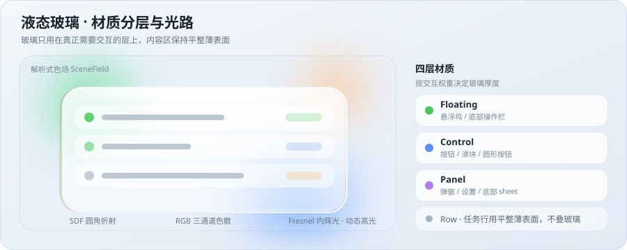
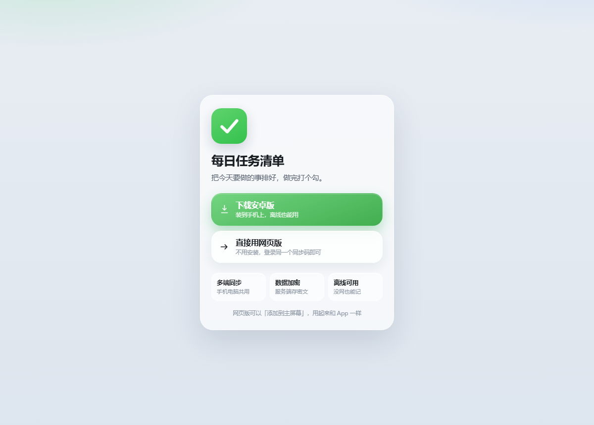
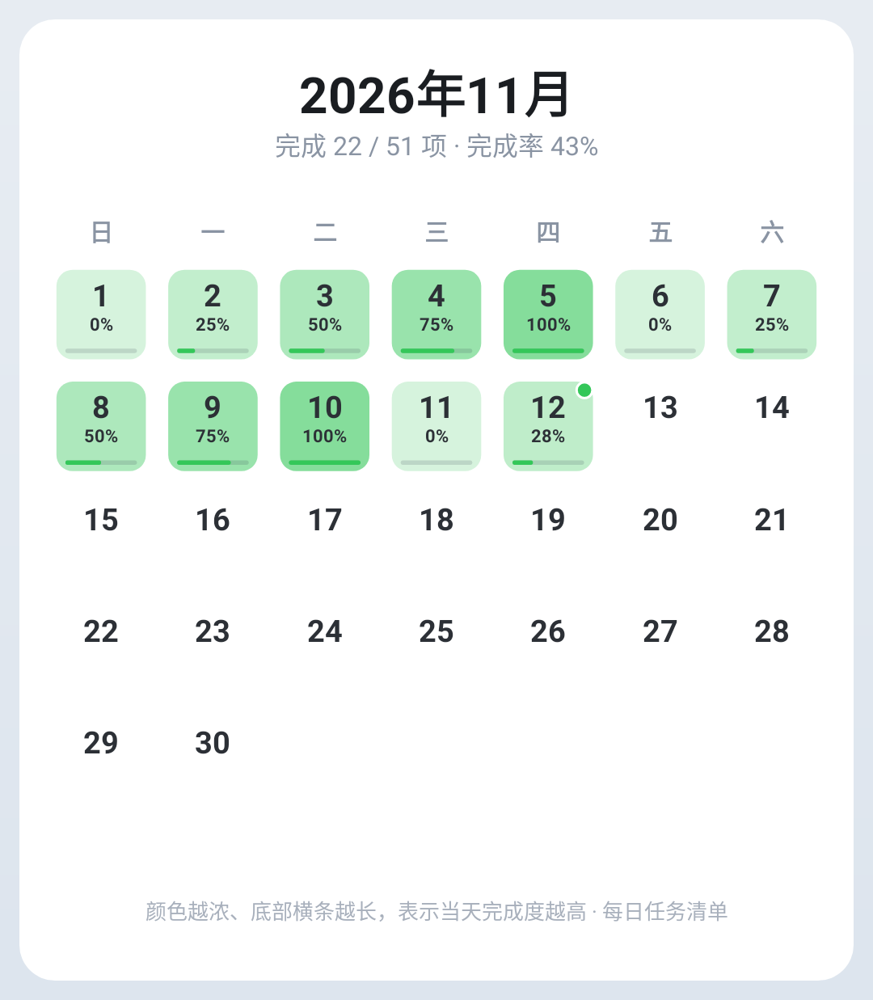

<div align="center">


# StudyTodo · 每日任务清单

**把今天要做的事排好，做完打个勾。**

一款以 **Android 原生 App** 为主的每日任务 / 学习记录工具：  
任务清单、学习时长、打卡复盘、日历导出、多端加密同步，配一套**液态玻璃**界面。

[](https://github.com/D-White-Bear-L/StudyTodo-Public/releases/tag/v1.43)
[](https://github.com/D-White-Bear-L/StudyTodo-Public/releases/tag/v1.43)
[](apps/native)
[](docs/sync.md)
[](docs/config.md)

<p>
  <a href="https://github.com/D-White-Bear-L/StudyTodo-Public/releases/tag/v1.43"></a>
  <a href="docs/config.md"></a>
</p>

<sub>Android 13+ · v1.43 · 45 MB · <a href="https://github.com/D-White-Bear-L/StudyTodo-Public/releases/download/v1.43/todo.apk">直接下载 todo.apk</a> · <a href="docs/config.md">配置说明</a></sub>

</div>

---

## 目录

- [下载与入口](#下载与入口)
- [配置（自己部署必读）](#配置自己部署必读)
- [液态玻璃](#液态玻璃)
- [功能一览](#功能一览)
- [三种形态](#三种形态)
- [快速开始](#快速开始)
- [数据与隐私](#数据与隐私)
- [项目结构](#项目结构)
- [分支与版本](#分支与版本)
- [文档索引](#文档索引)
- [版本历史](#版本历史)

---

## 下载与入口

> [!TIP]
> **这是一个以手机 App 为主的产品。** 日常使用直接安装 Android 原生版；网页版是免安装的补充入口，需要自己部署一份服务，两端数据可通过同一个同步码共用。

| | 📱 **Android 原生版（推荐）** | 🌐 **网页版 / PWA** |
|:---|:---|:---|
| **入口** | [**v1.43 Release · todo.apk**](https://github.com/D-White-Bear-L/StudyTodo-Public/releases/download/v1.43/todo.apk) | 部署后访问你自己的站点，或本地 `npm run dev` |
| **技术** | Kotlin + Jetpack Compose，完整功能 | 原生 HTML/CSS/JS + PWA |
| **适合** | 日常主力、离线使用、自动备份、日历图片存相册 | 电脑上快速查看、临时设备、不想装包 |
| **额外** | 自动备份到「下载」目录，卸载也带不走 | Service Worker 离线缓存；「添加到主屏幕」后和 App 一样 |

两端数据默认都留在本机，在设置里填同一个同步码即可多端共用（见 [同步说明](docs/sync.md)）。

安装包覆盖更新即可，**不需要卸载重装**。签名由本机配置提供，见下节。

---

## 配置（自己部署必读）

> [!IMPORTANT]
> **仓库里不含任何真实服务器信息**：没有域名、没有服务器地址、没有同步码、没有密钥、没有签名文件。
> 所有环境相关的值都放在本机的 `.env`，该文件已被 `.gitignore` 排除；仓库只提供 `.env.example` 模板。
> 也就是说，clone 之后**先填配置，再构建**，就能跑在自己的环境里。

```bash
cp .env.example .env       # 1. 复制模板
#                           # 2. 编辑 .env，填自己的域名 / 路径 / 口令
npm run config:gen         # 3. 生成 nginx、systemd 配置到 build/（不入库）
```

| 变量组 | 关键项 | 作用 |
|:---|:---|:---|
| 站点 | `APP_DOMAIN` / `APP_BASE_URL` / `APK_URL` | 网页版与原生版的同步、下载地址；原生版在构建时注入 `BuildConfig.SYNC_BASE_URL` |
| 服务端 | `DEPLOY_DIR` / `SYNC_BIND` / `SYNC_PORT` / `SYNC_DB` / `SYNC_TOKEN` / `SYNC_SECRET` | 同步服务的数据、密钥、监听地址 |
| nginx | `NGINX_MAIN_CONF` / `SSL_CERT` / `SSL_KEY` / `ACCESS_LOG` | 生成站点配置、内联脚本用的路径 |
| 签名 | `ANDROID_KEYSTORE` / `ANDROID_KEY_ALIAS` / `*_PASSWORD` | 指向**本机**的 keystore，不随仓库分发 |

> [!WARNING]
> 请自己生成 keystore 并离线备份。签名一旦更换，手机上已安装的版本只能卸载重装，本地记录会一起丢失。
> 生成方式、变量含义与三种典型场景见 [**docs/config.md**](docs/config.md)。
> 不要把 `.env`、keystore、密钥文件或任何本地笔记提交进仓库。

只装 App、不部署服务端的话，`.env` 可以完全不填——数据默认只存本机。

---

## 液态玻璃

界面不是简单的「半透明白卡片」，而是**在第三方 AGSL 玻璃组件库 [PrismalAGSL](https://github.com/styropyr0/PrismalAGSL)（`com.github.styropyr0:PrismalAGSL:1.0.4`）的基础上做的二次完善**（`PrismalGlass.kt` / `LiquidMaterial.kt`）。玻璃只用在真正需要交互的层上，内容区保持平整薄表面，避免变成一堆糊在一起的卡片。

<p align="center">
  
</p>

<p align="center"><sub>材质分层与光路示意（原理图，非界面截图）</sub></p>

**分工**：底层的折射、色散与边缘高光由 PrismalAGSL 的 AGSL 着色器提供（API 33+）；在此之上补了：

| 补充部分 | 说明 |
|:---|:---|
| 四层材质 | `Floating`（悬浮坞）/ `Control`（按钮、滑块）/ `Panel`（弹窗、设置）/ `Row`（任务行），按交互权重决定玻璃厚度，`PrismalGlass.kt` 统一封装 |
| 色场与降级 | `LiquidMaterial.kt` 的解析式色场 `SceneField` + CPU 按像素采样、圆角矩形 SDF 折射；不支持 AGSL 时走这条降级路径 |
| 光学细节 | RGB 三通道位移产生色散、内部轻微增饱和、烘焙 Fresnel 内辉光 / 斜向边缘高光 / 内壁辉光 / 底部内阴影、细颗粒模拟光学噪点 |
| 动态高光 | 顶部镜面椭圆高光跟随重力感应与手指位置移动 |

**外观**：深浅模式自动适配，9 种预设主题色 + 自研 HSV 圆形色盘自由取色，标签颜色与日历主题色都能单独调。

<details>
<summary>真实产物预览</summary>

<p align="center">
  
  
</p>

<p align="center"><sub>左：网页版入口；右：App 导出的日历图片（Robolectric 离屏渲染的真实产物）</sub></p>

</details>

---

## 功能一览

| 分类 | 能力 |
|:---|:---|
| **任务** | 新增 / 编辑 / 删除 / 完成切换 / 多选批量操作；手动拖拽排序（拖到边缘自动滚动）、未完成优先、按学科分组，三态切换并记住 |
| **日期** | 前后翻天、回到今天、最近 7 天、日历选择；未完成任务可迁移到指定日期，支持只迁部分、保留原任务（复制） |
| **标签** | 默认 6 个学科标签，可增删改名换色；删除时由你选择任务并到哪个标签 |
| **学习** | 总时长、开始时间、地点、复盘时间，支持「沿用上一日」 |
| **打卡** | 连续天数、累计次数、日历热力底色 |
| **导出** | 每日计划（文本）、每日总结（按学科分组 + 完成率）、日历图片（1080 宽 PNG，可存相册 / 分享） |
| **同步** | 记录级增量同步，多端共用一份数据，离线改动联网自动补传，删除不会复活 |
| **备份** | App 默认自动备份到「下载」目录；也可手动导出 / 导入 JSON（合并或覆盖），三端互通 |
| **外观** | 液态玻璃、9 种主题色 + 自定义取色、深浅模式 |

---

## 三种形态

同一份产品做了三种技术实现，功能一致，可以并存安装。**对外只分发原生版 App**。

| 形态 | 目录 | 技术 | 产物 |
|:---|:---|:---|:---|
| **① 原生版 App（主）** | `apps/native` | Kotlin + Jetpack Compose | `todo.apk` — 对外分发 |
| ② 兼容版 APK | `apps/webview` | Capacitor 套壳（WebView） | `*-webview-*.apk` — 备用 |
| ③ 网页版 / PWA | `apps/web` | 原生 HTML/CSS/JS | 自己部署的站点 — 免安装入口 |

- 原生版是独立实现，数据层用 SharedPreferences + JSON，不依赖 WebView，是日常使用的主力。
- 网页版同时是**兼容版的 UI 真源**：改网页样式 / 交互先改 `apps/web`，再同步进套壳工程。
- 网页版按 `location.origin` 拼同步地址，原生版地址由 `.env` 在构建时注入，两端都不在源码里写死主机。
- 三端共用同一套数据模型与同步协议，记录 key 完全一致，可互相导入导出。

---

## 快速开始

**只想用 App**：从 [v1.43 Release](https://github.com/D-White-Bear-L/StudyTodo-Public/releases/tag/v1.43) 下载安装 → 直接用（默认本机存储，不依赖服务端）。

**本地开发**：

```bash
cp .env.example .env       # 填自己的配置（只装 App 可跳过）
npm run config:gen         # 生成部署配置
npm run dev                # 网页版预览 http://127.0.0.1:8899
npm run build:native       # 打原生版 APK
npm run build:all          # 原生版 + 兼容版都打
npm run publish:prepare    # 组装发布目录
```

构建、发布、离屏渲染截图与环境要求见 [**docs/build.md**](docs/build.md)。

---

## 数据与隐私

- 数据**默认只存在本机**：网页版 `localStorage`，原生版 `SharedPreferences`，不上传也能用。
- 开启云端同步后，服务端用 **AES-256-GCM** 加密记录内容；同步走 HTTPS + 同步码鉴权。
- **加密密钥由部署者自己保管**：丢失后已加密的数据无法恢复，请离线备份。密钥、同步码、签名文件都不在仓库里。
- 导出的备份 JSON 是**明文**，注意别随手转发。

同步协议见 [docs/sync.md](docs/sync.md)，数据模型与备份格式见 [docs/data.md](docs/data.md)。

---

## 项目结构

```
.
├── .env.example         # 配置模板（唯一的「填这里」入口）
├── apps/
│   ├── native/          # ① Android 原生 App（主）：Compose UI + 数据 + 同步 + 液态玻璃
│   ├── web/             # ③ 网页版 / PWA，也是兼容版的 UI 真源
│   └── webview/         # ② Capacitor 套壳工程
├── docs/                # 技术文档 + 界面预览图
├── scripts/             # 构建脚本 + config.js / gen-config.js（读 .env）
├── server/              # 同步服务（Python 单文件 + 配置模板 + 测试）
├── assets/              # 图标生成脚本
├── backup/              # 本地数据备份（不入库）
├── build/               # 构建产物与生成的部署配置（不入库）
└── release/             # APK 输出（不入库，走 Release 分发）
```

完整目录与功能清单见 [docs/architecture.md](docs/architecture.md)。

---

## 分支与版本

| 分支 / 标记 | 用途 | 规则 |
|:---|:---|:---|
| `main` | 稳定发布版，对应正在分发的版本 | 只接受从 `develop` 合并，合并时打版本 tag |
| `develop` | 日常开发主线 | 功能改动先落这里，验证通过后合入 `main` |
| `v1.xx` | 版本标签，对应一次实际发布的 APK | 附注 tag，配套 GitHub Release 附件 |

```bash
git checkout develop          # 日常开发
git push origin develop
git checkout main && git merge --ff-only develop
git tag -a v1.44 -m "v1.44"  # 发布时打 tag
git push origin main --tags
```

**配置不入库，所以仓库可以公开**：`.env`、keystore、密钥、同步码、个人数据备份与本地私有笔记都在 `.gitignore` 里。日常维护也请照着 [docs/config.md#开源前检查](docs/config.md#开源前检查) 保持仓库干净。

---

## 文档索引

| 文档 | 内容 |
|:---|:---|
| [docs/config.md](docs/config.md) | **配置外置说明**：每个变量的含义、三种典型场景、开源前检查清单 |
| [docs/architecture.md](docs/architecture.md) | 三端形态、完整目录、数据模型、功能清单、完整版本历史 |
| [docs/build.md](docs/build.md) | 构建命令、发布流程、离屏渲染截图、环境要求 |
| [docs/sync.md](docs/sync.md) | 同步协议、记录 key、接口、测试 |
| [docs/data.md](docs/data.md) | 数据备份格式、导入导出、旧版 PDF 历史记录迁移 |

---

## 版本历史

| 版本 | 日期 | 主要变更 |
|:---|:---|:---|
| **v1.43** | 2026-11-12 | 接入自有域名并去掉客户端里的主机地址；安装包固定 `todo.apk`；修 Service Worker 误缓存 `/sync` 导致同步读到旧数据 |
| v1.41 | 2026-11-12 | 原生版接入云端同步，`Sync.kt` 与网页版协议逐字一致，设置页新增同步区块 |
| v1.40 | 2026-11-12 | 删除标签可自选去处，不再一律并到「数学」 |
| v1.39 | 2026-11-12 | 签名固定到本机 keystore；新增自动备份到「下载」目录 |
| v1.38 | 2026-11-12 | 迁移增强（部分迁移 / 复制）、弹窗统一、日历完成度可读性 |
| v1.8 | 2026-11-02 | 液态玻璃改以 PrismalAGSL 为底座，补自研色场、材质分层与动态高光 |
| — | 2026-11-12 | 配置外置：域名 / 路径 / 签名抽到 `.env`，仓库与文档脱敏，为公开做准备 |

完整历史见 [docs/architecture.md#版本历史](docs/architecture.md#版本历史)。

---

<div align="center">
<sub>数据默认留在本机 · <a href="https://github.com/D-White-Bear-L/StudyTodo-Public/releases/tag/v1.43">下载 App</a> · <a href="docs/config.md">配置说明</a></sub>
</div>
